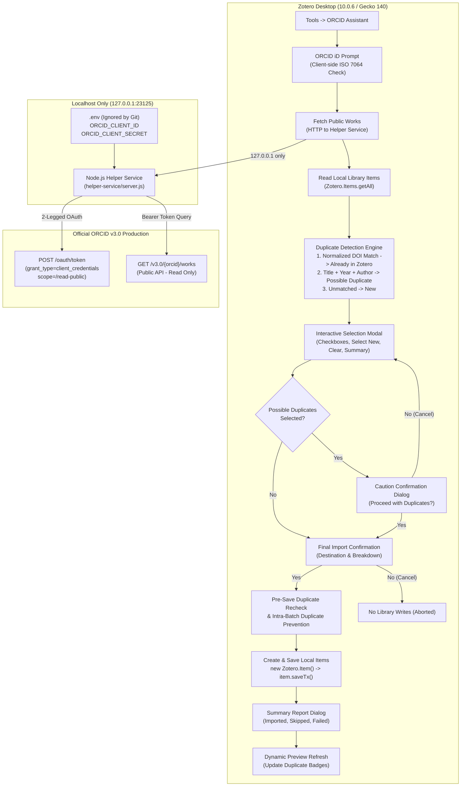

# ORCID Assistant for Zotero 7+

**ORCID Assistant** is an open-source Zotero desktop plugin designed to streamline importing, verifying, and linking researcher publication records from [ORCID](https://orcid.org) directly into your local Zotero library.

> **Step 4 Implementation Status: Selected Publication Import to Local Zotero Library**  
> Builds on the verified Step 1 lifecycle, Step 2 local helper service, and Step 3 duplicate detection engine:
> * **Interactive Selection UI**: View fetched publications with individual checkboxes, title, authors, publication year, DOI, work type, and duplicate status badges (`Already in Zotero`, `Possible Duplicate`, `New`).
> * **Safe Selection Defaults**: `New` records are pre-selected by default; `Already in Zotero` and `Possible Duplicate` records are unselected by default.
> * **Selection Controls**: One-click **Select New**, **Clear Selection**, and real-time selected count (`X of Y selected`).
> * **Explicit Two-Stage Confirmation**:
>   1. **Possible Duplicates Safeguard**: Selecting any record flagged as `Possible Duplicate` requires explicit user confirmation before proceeding.
>   2. **Pre-Import Confirmation**: Shows a confirmation dialog specifying the destination library and item count breakdown. Cancellation performs **zero** write operations.
> * **Official Zotero Item Creation**: Creates items in the local library using official Zotero 7+ APIs (`new Zotero.Item()`, `item.setField()`, `item.setCreators()`, `await item.saveTx()`).
> * **Metadata & Field Mapping**: Maps ORCID work types to Zotero item types (`journalArticle`, `book`, `bookSection`, `conferencePaper`, `report`, `thesis`, `patent`, `preprint`, `dataset`, `manuscript`). Sets title, normalized DOI, year/date, publication/journal title, URL, provenance extra field (`ORCID: ...`, `ORCID-Put-Code: ...`), and author creators with institutional single-field support (`fieldMode: 1`).
> * **Immediate Pre-Save Duplicate Recheck**: Rechecks library items immediately before saving and prevents intra-batch duplicate creation when multiple works share a DOI.
> * **Granular Import Reporting**: Separates and reports `Imported`, `Skipped (duplicates)`, and `Failed` items.
> * **Dynamic Status Refresh**: Automatically refreshes preview cards and duplicate tags after import.
> * **Strict ORCID Read-Only Guarantee**: Writes strictly to the user's local Zotero library; strictly read-only from ORCID (no ORCID write scopes requested, no publication editing, pushing, or deletion).

---

## 1. Architecture & Data Flow



### Components

* **`src/manifest.json`**: WebExtension manifest (`manifest_version: 2`) configured with `applications.zotero` (`strict_min_version: "7.0"`, `strict_max_version: "10.0.*"`, and `update_url`).
* **`src/bootstrap.js`**: Gecko restartless lifecycle hooks (`startup`, `shutdown`, `onMainWindowLoad`, etc.).
* **`src/orcid-assistant.js`**: Core plugin logic. Manages `Zotero.MenuManager` integration, input dialogs, client-side ORCID normalization/checksum verification, helper communication, local duplicate detection, interactive modal UI, item creation, pre-save duplicate rechecking, and import execution.
* **`helper-service/server.js`**: Localhost-only HTTP server bound strictly to `127.0.0.1:23125`. Exposes `/health` and `/api/works` endpoints. Never logs or leaks secrets.
* **`helper-service/orcid-client.js`**: 2-legged OAuth token management (in-memory TTL cache) and ORCID v3.0 works parser extracting titles, authors, DOIs, years, and types.
* **`.env.example`**: Safe configuration template for local development credentials.
* **`scripts/build.js`**: Packages only `src/` into `dist/orcid-assistant.xpi` (strictly isolates `.env` and `helper-service/`).
* **`scripts/test.js`**: Automated plugin tests (200 passing assertions).
* **`helper-service/test.js`**: Automated helper service tests (34 passing assertions).

---

## 2. Duplicate Detection & Selection Hierarchy

The duplicate detection engine compares each retrieved ORCID publication against the items in your local Zotero library using the following precedence rules:

| Priority | Match Type | Criteria | Status Label | Default Selection |
| :--- | :--- | :--- | :--- | :--- |
| **1 (Strongest)** | **Normalized DOI** | Normalized DOIs match exactly (case-insensitive, URL prefixes `https://doi.org/`, `http://dx.doi.org/`, and `doi:` stripped). | **`[Already in Zotero]`** | **Unchecked** (Excluded by default) |
| **2 (Secondary)** | **Title + Year + Author** | DOI missing on one or both records; normalized titles match, publication years match, and author metadata aligns. | **`[Possible Duplicate]`** | **Unchecked** (Requires caution confirmation) |
| **3 (Secondary)** | **Title + Author** | DOI missing on one or both records, year unavailable on one or both, but normalized titles match and author metadata aligns. | **`[Possible Duplicate]`** | **Unchecked** (Requires caution confirmation) |
| **4 (Negative)** | **Title-Only Similarity** | Titles match, but publication years conflict (e.g. 2012 vs 2021), authors conflict, or both year and author are missing. | **`[New]`** *(Title-only similarity is never treated as duplicate)* | **Checked** |
| **5 (Unmatched)** | **No Match** | No matching DOI, title, or authors found in the local library. | **`[New]`** | **Checked** |
| **6 (Edge Case)** | **Empty Library** | When local library contains 0 items, all fetched publications are safely labeled. | **`[New]`** | **Checked** |

---

## 3. Metadata & Field Mapping Table

When publications are imported into your local Zotero library, ORCID metadata is mapped to Zotero item types and fields as follows:

| ORCID Work Type | Zotero Item Type | Mapped Fields | Notes |
| :--- | :--- | :--- | :--- |
| `journal-article`, `journal-issue` | `journalArticle` | `title`, `DOI`, `date`, `publicationTitle`, `url`, `creators`, `extra` | Journal title mapped to `publicationTitle`. |
| `book`, `edited-book` | `book` | `title`, `DOI`, `date`, `publisher`, `url`, `creators`, `extra` | Book title and publisher populated. |
| `book-chapter`, `book-section` | `bookSection` | `title`, `DOI`, `date`, `publicationTitle`, `url`, `creators`, `extra` | Chapter/section item type. |
| `conference-paper`, `proceedings-article` | `conferencePaper` | `title`, `DOI`, `date`, `publicationTitle`, `url`, `creators`, `extra` | Conference paper item type. |
| `report` | `report` | `title`, `DOI`, `date`, `url`, `creators`, `extra` | Technical/scientific report. |
| `dissertation`, `dissertation-thesis` | `thesis` | `title`, `date`, `url`, `creators`, `extra` | Academic dissertation/thesis. |
| `patent` | `patent` | `title`, `date`, `url`, `creators`, `extra` | Patent record. |
| `preprint` | `preprint` | `title`, `DOI`, `date`, `url`, `creators`, `extra` | Working paper / preprint. |
| `data-set` | `dataset` | `title`, `DOI`, `date`, `url`, `creators`, `extra` | Research dataset. |
| *Other / Unknown* | `journalArticle` | `title`, `DOI`, `date`, `url`, `creators`, `extra` | Safe fallback without metadata loss. |

### Creator & Provenance Mapping
* **Author Formatting**: Automatically parses `Last, First` and `First Middle Last`.
* **Institutional Authors**: Names containing organizational terms (e.g., `Collaboration`, `Consortium`, `University`, `Institute`, `Laboratory`) or single-word organization names are preserved with `fieldMode: 1` so Zotero treats them as a single entity rather than reversing first and last names.
* **Provenance in `extra` Field**: Appends `ORCID: {orcid}` and `ORCID-Put-Code: {putCode}` to the item's `extra` field for traceability and future re-linking.

---

## 4. Safe Local Setup Instructions

### Prerequisites
* **Node.js**: v18+ (tested on Node v24.18.0)
* **Zotero Desktop**: Zotero 7.0+ or Zotero 10.0.6
* **ORCID Public API Credentials**: Register a free application at [orcid.org/developer-tools](https://orcid.org/developer-tools) to obtain a Client ID and Client Secret.

### Step 1: Install Dependencies
```bash
npm install
```

### Step 2: Configure Local Environment
Copy the example environment file:
```bash
cp .env.example .env
```
*(On Windows PowerShell: `Copy-Item .env.example .env`)*

Edit `.env` with your ORCID Public API credentials:
```env
PORT=23125
HOST=127.0.0.1
ORCID_CLIENT_ID=APP-XXXXXXXXXXXXXXXX
ORCID_CLIENT_SECRET=xxxxxxxx-xxxx-xxxx-xxxx-xxxxxxxxxxxx
```

### Step 3: Start the Local Helper Service
In a terminal window:
```bash
npm run helper
```
Output:
```
[Helper] Loading environment from: .../.env
[Helper] Service running on http://127.0.0.1:23125
[Helper] Security notice: Bound to localhost only.
```

### Step 4: Build and Package Plugin
In a second terminal window:
```bash
npm run package
```
This packages `dist/orcid-assistant.xpi` and runs the full automated test suite (234 checks across plugin and helper).

---

## 5. Manual Installation & Testing in Zotero

### Safe Testing Recommendation
> [!TIP]
> For safe local testing without touching your primary library, we recommend using a test collection or a dedicated Zotero testing profile:
> * Start Zotero with `zotero.exe -P` to launch the Profile Manager and create a temporary test profile.

### Step 5.1: Install the Plugin
1. Open Zotero.
2. In the top menubar, navigate to **Tools** → **Plugins** (or **Tools** → **Add-ons**).
3. Click the gear icon (⚙️) located in the upper-right corner.
4. Select **"Install Add-on From File..."**.
5. Select `dist/orcid-assistant.xpi` from this project folder.
6. Click **Install**. The add-on activates immediately without restarting.

### Step 5.2: Launch ORCID Assistant
1. In Zotero, click **Tools** → **ORCID Assistant**.
2. An input dialog appears with the prompt:
   > *ORCID Assistant is running.*  
   > *Enter an ORCID iD to preview public works:*
3. Enter an ORCID identifier (e.g., `0000-0002-1825-0097` or another public profile).
4. Click **OK**.

### Step 5.3: Select Publications & Confirm Import
1. The **ORCID Assistant — Public Works Import** window opens.
2. Review the detected works:
   * Status badges show **`New`**, **`Possible Duplicate`**, and **`Already in Zotero`**.
   * Only `New` publications are selected by default.
   * Use **Select New** to restore default selection or **Clear Selection** to uncheck all.
3. Click **Import Selected (N)**:
   * If any `Possible Duplicate` was checked, a cautionary confirmation dialog is displayed.
   * A final confirmation dialog presents the target library (`My Library`) and count breakdown.
   * Clicking **Cancel** performs **zero** write operations.
4. Upon clicking **OK**, items are saved via `saveTx()` to your local Zotero library.
5. An **Import Summary** dialog displays the count of imported, skipped, and failed records.
6. The modal dynamically refreshes to reflect newly imported items as `Already in Zotero`.

---

## 6. Automated Test Suite (234 Passing Tests)

Run all tests:
```bash
npm test
```

### Plugin Verification (`scripts/test.js` - 200 Tests)
* **Manifest & Compatibility**: Manifest v2 compatibility and strict version bounds (`7.0` - `10.0.*`).
* **Gecko Lifecycle**: Startup, shutdown, window attachment, Tools menu registration, clean cleanup.
* **Step 1 Dialog**: Preserved `ORCID Assistant is running.` confirmation dialog.
* **ORCID Validation**: Format regex, URL prefix normalization, and ISO 7064 MOD 11-2 check digit verification.
* **Helper Client**: Mocked success, empty works, missing credentials, 404 not found, network offline, and timeout responses.
* **Duplicate Detection Matrix**:
  * Exact normalized DOI match -> `[Already in Zotero]`.
  * DOI casing and prefix variations -> `[Already in Zotero]`.
  * Missing DOI with matching title + year + author -> `[Possible Duplicate]`.
  * Title variations (punctuation/case) with matching year & author -> `[Possible Duplicate]`.
  * Missing year on both with matching author -> `[Possible Duplicate]`.
  * Missing author with matching year -> `[Possible Duplicate]`.
  * Same title, but conflicting years -> `[New]` (title-only similarity NOT treated as duplicate).
  * Same title, but conflicting authors -> `[New]`.
  * Same title, but both year and author missing -> `[New]`.
  * Unmatched paper -> `[New]`.
  * Empty local library -> All works labeled `[New]`.
* **Step 4 Metadata Mapping & Item Construction**:
  * Mapping of 10+ ORCID work types to official Zotero item types.
  * Author parsing: `Last, First`, `First Last`, and institutional/collaboration names (`fieldMode: 1`).
  * Field setting: title, normalized DOI, year/date, journal/publication title, URL, creators, and `extra` provenance (`ORCID: ...`, `ORCID-Put-Code: ...`).
  * Graceful handling of missing fields without inventing values.
* **Step 4 Import Execution & Duplicate Recheck Safeguards**:
  * Pre-save duplicate rechecking: items detected as duplicates immediately before save are skipped.
  * Intra-batch duplicate prevention: multiple items in the same batch sharing a DOI save only once and skip duplicates.
  * Partial failure handling: failing items do not block other valid items; failures and errors are separated and reported.
  * Empty batch handling.
* **Step 4 Confirmation Dialogs**:
  * User cancellation at Possible Duplicates prompt aborts import.
  * User cancellation at final import prompt performs zero write operations.
  * Correct target library and breakdown display.
* **Step 4 Selection UI (DOM Modal)**:
  * Modal overlay rendering and cleanup via `removeFromWindow`.
  * Default selection state (`New` checked; `Already in Zotero` and `Possible Duplicate` unchecked).
  * Live selection summary count updates (`1 of 3 selected`).
* **Security & Non-Interference**:
  * Helper service requests strictly `/read-public` scope (no `/activities/update`, no `/read-limited`).
  * Helper service issues strictly `GET` requests for works; zero `PUT` or `DELETE` requests.
  * Plugin issues zero `POST`, `PUT`, or `DELETE` requests to ORCID.
  * XPI archive verification: strictly excludes `.env`, helper service files, and client credentials.

### Helper Service Verification (`helper-service/test.js` - 34 Tests)
* ISO 7064 check digit validation unit tests.
* Credential missing detection and error sanitization.
* Mocked 2-legged OAuth token acquisition (`/read-public`) and in-memory TTL caching.
* Mocked ORCID API v3.0 works parsing, including author/contributor extraction.
* Error handling for 404 and empty profiles.
* Live HTTP server endpoint tests on an ephemeral port (`GET /health`, `GET /api/works`).

---

## 7. Safety & Security Guarantees
* **Local Library Write Only**: Items are created strictly in the user's local Zotero library using official `Zotero.Item` APIs (`saveTx()`).
* **Strictly Read-Only from ORCID**: Zero write scopes are requested (`/activities/update` is never used). The plugin never modifies, pushes, or deletes records on ORCID.
* **Credential Isolation**: Client secret and `.env` file remain exclusively on the local machine and are **never** packaged into `dist/orcid-assistant.xpi`.
* **Explicit User Confirmation**: No items are ever imported automatically when opening the plugin or previewing results.
* **Zero Zotero Core Modifications**: Completely self-contained as a clean, restartless add-on.
