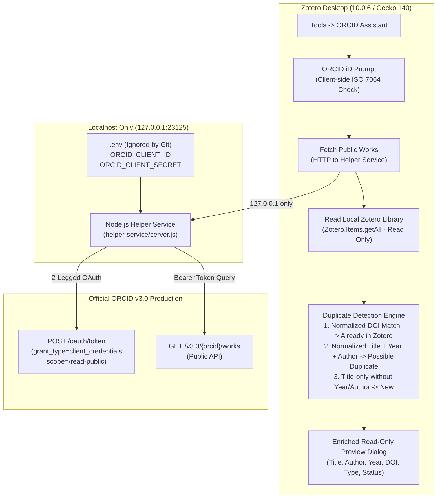

# ORCID Assistant for Zotero 7+

**ORCID Assistant** is an open-source Zotero desktop plugin designed to streamline importing, verifying, and linking researcher publication records with [ORCID](https://orcid.org).

> **Step 3 Implementation Status:** Builds upon the verified Step 1 lifecycle foundation and Step 2 local helper service. Adds local Zotero library inspection and intelligent duplicate detection:
> * **Strongest Match (Normalized DOI)**: Compares normalized DOIs across formats, prefixes, and casing -> labeled **`Already in Zotero`**.
> * **Secondary Match (Missing DOI)**: When DOI is missing on either record, compares normalized titles + publication year + available author metadata -> labeled **`Possible Duplicate`**.
> * **Title-Only Similarity**: Title-only resemblance is strictly **NOT** treated as a confirmed duplicate when years conflict, authors conflict, or year/author metadata is absent -> labeled **`New`**.
> * **Enriched Read-Only Preview**: Displays title, authors (when available), publication year, DOI, work type, duplicate status tags, match explanation, and duplicate summary statistics.
>
> **Strict Read-Only Guarantee:** No items are created, imported, edited, deleted, or pushed in your Zotero library. All operations are strictly read-only inspection.

---

## 1. Architecture & Design



### Components

* **`src/manifest.json`**: WebExtension manifest (`manifest_version: 2`) configured with `applications.zotero` (`strict_min_version: "7.0"`, `strict_max_version: "10.0.*"`, and `update_url`).
* **`src/bootstrap.js`**: Gecko restartless lifecycle hooks (`startup`, `shutdown`, `onMainWindowLoad`, etc.).
* **`src/orcid-assistant.js`**: Core plugin logic. Manages `Zotero.MenuManager` integration, input dialogs, client-side ORCID normalization/checksum verification, local helper communication, local library duplicate detection, and enriched read-only preview rendering.
* **`helper-service/server.js`**: Localhost-only HTTP server bound strictly to `127.0.0.1:23125`. Exposes `/health` and `/api/works` endpoints. Never logs or leaks secrets.
* **`helper-service/orcid-client.js`**: 2-legged OAuth token management (in-memory TTL cache) and ORCID v3.0 works parser extracting titles, authors, DOIs, years, and types.
* **`.env.example`**: Safe configuration template for local development credentials.
* **`scripts/build.js`**: Packages only `src/` into `dist/orcid-assistant.xpi` (strictly isolates `.env` and `helper-service/`).
* **`scripts/test.js`**: Automated plugin tests (125 passing assertions).
* **`helper-service/test.js`**: Automated helper service tests (34 passing assertions).

---

## 2. Duplicate Detection Hierarchy

The duplicate detection engine compares each retrieved ORCID publication against the items in your local Zotero library using the following precedence rules:

| Priority | Match Type | Criteria | Status Label |
| :--- | :--- | :--- | :--- |
| **1 (Strongest)** | **Normalized DOI** | Normalized DOIs match exactly (case-insensitive, URL prefixes `https://doi.org/`, `http://dx.doi.org/`, and `doi:` stripped). | **`[Already in Zotero]`** |
| **2 (Secondary)** | **Title + Year + Author** | DOI is missing on one or both records; normalized titles match, publication years match, and author metadata aligns. | **`[Possible Duplicate]`** |
| **3 (Secondary)** | **Title + Author** | DOI is missing on one or both records, year is unavailable on one or both, but normalized titles match and author metadata aligns. | **`[Possible Duplicate]`** |
| **4 (Negative)** | **Title-Only Similarity** | Titles match, but publication years conflict (e.g. 2012 vs 2021), authors conflict, or both year and author are missing. | **`[New]`** *(Title-only similarity is never treated as a duplicate)* |
| **5 (Unmatched)** | **No Match** | No matching DOI, title, or authors found in the local library. | **`[New]`** |
| **6 (Edge Case)** | **Empty Library** | When local library contains 0 items, all fetched publications are safely labeled. | **`[New]`** |

---

## 3. Safe Local Setup Instructions

### Prerequisites
* **Node.js**: v18+ (tested on Node v24.18.0)
* **Zotero Desktop**: Zotero 7.0+ or Zotero 10.0.6
* **ORCID Public API Credentials**: Register a free application at [orcid.org/developer-tools](https://orcid.org/developer-tools) to obtain a Client ID and Client Secret.

### Step 1: Install Dependencies
```bash
npm install
```

### Step 2: Configure Local Environment
Copy the example environment file:
```bash
cp .env.example .env
```
*(On Windows PowerShell: `Copy-Item .env.example .env`)*

Edit `.env` with your ORCID Public API credentials:
```env
PORT=23125
HOST=127.0.0.1
ORCID_CLIENT_ID=APP-XXXXXXXXXXXXXXXX
ORCID_CLIENT_SECRET=xxxxxxxx-xxxx-xxxx-xxxx-xxxxxxxxxxxx
```

### Step 3: Start the Local Helper Service
In a terminal window:
```bash
npm run helper
```
Output:
```
[Helper] Loading environment from: .../.env
[Helper] Service running on http://127.0.0.1:23125
[Helper] Security notice: Bound to localhost only.
```

### Step 4: Build and Package Plugin
In a second terminal window:
```bash
npm run package
```
This packages `dist/orcid-assistant.xpi` and runs the full automated test suite (159 checks across plugin and helper).

---

## 4. Manual Installation in Zotero

1. Open Zotero.
2. In the top menubar, navigate to **Tools** → **Plugins** (or **Tools** → **Add-ons**).
3. Click the gear icon (⚙️) located in the upper-right corner.
4. Select **"Install Add-on From File..."**.
5. Select `dist/orcid-assistant.xpi` from this project folder.
6. Click **Install**. The add-on activates immediately without restarting.

---

## 5. Testing the Step 3 Duplicate Detection & Preview

### Step 5.1: Trigger Public Works Fetch
1. In Zotero, click **Tools** → **ORCID Assistant**.
2. An input dialog appears with the prompt:
   > *ORCID Assistant is running.*  
   > *Enter an ORCID iD to preview public works:*
3. Enter an ORCID identifier (e.g., `0000-0002-1825-0097` or a researcher's profile).
4. Click **OK**.

### Step 5.2: Inspect Enriched Read-Only Preview
A dialog opens displaying the fetched results categorized by local duplicate status:
```text
ORCID Public Works Preview (6 works found)
==================================================
ORCID iD:    0000-0002-1825-0097
Total Works: 6
Detection:   1 Already in Zotero | 1 Possible Duplicate | 4 New
--------------------------------------------------
[1] [Already in Zotero]
    Title:   A Methodology for the Emulation of Architecture
    Authors: Josiah Carberry
    Year:    2012
    DOI:     10.5555/12345680
    Type:    journal-article
    Match:   Matched DOI: 10.5555/12345680

[2] [Possible Duplicate]
    Title:   The Memory Bus Considered Harmful
    Authors: Josiah Carberry
    Year:    2012
    DOI:     None
    Type:    journal-article
    Match:   Title, year (2012), and author match local item

[3] [New]
    Title:   Bulk and surface plasmons in artificially structured materials
    Authors: Josiah Carberry
    Year:    1987
    DOI:     10.1109/TPS.1987.4316723
    Type:    journal-article

==================================================
READ-ONLY PREVIEW: No items were imported, created,
modified, edited, deleted, or pushed in your Zotero library.
==================================================
```
5. Click **OK**. A follow-up prompt will ask:
   > *Would you like to fetch public works for another ORCID iD?*
6. Select **Cancel** to finish or **OK** to enter another identifier.

---

## 6. Automated Test Suite (159 Passing Tests)

Run all tests:
```bash
npm test
```

### Plugin Verification (`scripts/test.js` - 125 Tests)
* **Manifest & Architecture**: Manifest v2 compatibility and strict version bounds (`7.0` - `10.0.*`).
* **Gecko Lifecycle**: Startup, shutdown, window attachment, Tools menu registration, clean cleanup.
* **Step 1 Dialog**: Preserved `ORCID Assistant is running.` confirmation dialog.
* **ORCID Validation**: Format regex, URL prefixes normalization, and ISO 7064 MOD 11-2 check digit verification.
* **Helper Client**: Mocked success, empty works, missing credentials, 404 not found, network offline, and timeout responses.
* **Normalization**:
  * DOI normalization (case-insensitivity, `https://doi.org/`, `http://dx.doi.org/`, `doi:`, trailing slashes/dots).
  * Title normalization (HTML stripping, punctuation removal, whitespace collapsing).
  * Publication year extraction from ISO dates, strings, and numbers.
  * Author token extraction and matching.
* **Duplicate Detection Matrix**:
  * Exact normalized DOI match -> `[Already in Zotero]`.
  * DOI casing and prefix variations -> `[Already in Zotero]`.
  * Missing DOI with matching title + year + author -> `[Possible Duplicate]`.
  * Title variations (punctuation/case) with matching year & author -> `[Possible Duplicate]`.
  * Missing year on both with matching author -> `[Possible Duplicate]`.
  * Missing author with matching year -> `[Possible Duplicate]`.
  * Same title, but conflicting years -> `[New]` (title-only similarity NOT treated as duplicate).
  * Same title, but conflicting authors -> `[New]`.
  * Same title, but both year and author missing -> `[New]`.
  * Unmatched paper -> `[New]`.
  * Empty local library -> All works labeled `[New]`.
* **Statistics & UI Integration**: Accurate counts for already, possible, and new works, and preview alert dialog rendering.
* **Strict Read-Only Guarantee**: Asserts zero calls to `Zotero.Items` write APIs.
* **Archive Security**: Confirms `.env`, credentials, and `helper-service/` are strictly excluded from `.xpi`.

### Helper Service Verification (`helper-service/test.js` - 34 Tests)
* ISO 7064 check digit validation unit tests.
* Credential missing detection and error sanitization.
* Mocked 2-legged OAuth token acquisition (`/read-public`) and in-memory TTL caching.
* Mocked ORCID API v3.0 works parsing, including author/contributor extraction.
* Error handling for 404 and empty profiles.
* Live HTTP server endpoint tests on an ephemeral port (`GET /health`, `GET /api/works`).

---

## 7. Safety & Non-Interference Guarantees
* **No Database Mutation**: Does not alter SQLite tables or create, edit, or delete bibliographic records.
* **No Automatic Sync**: Does not write to ORCID or schedule background synchronizations.
* **Zero Zotero Core Modifications**: Completely contained within the independent `.xpi` add-on.
* **Localhost-Only Networking**: The helper service communicates with ORCID on your behalf and exposes only `127.0.0.1` locally.
