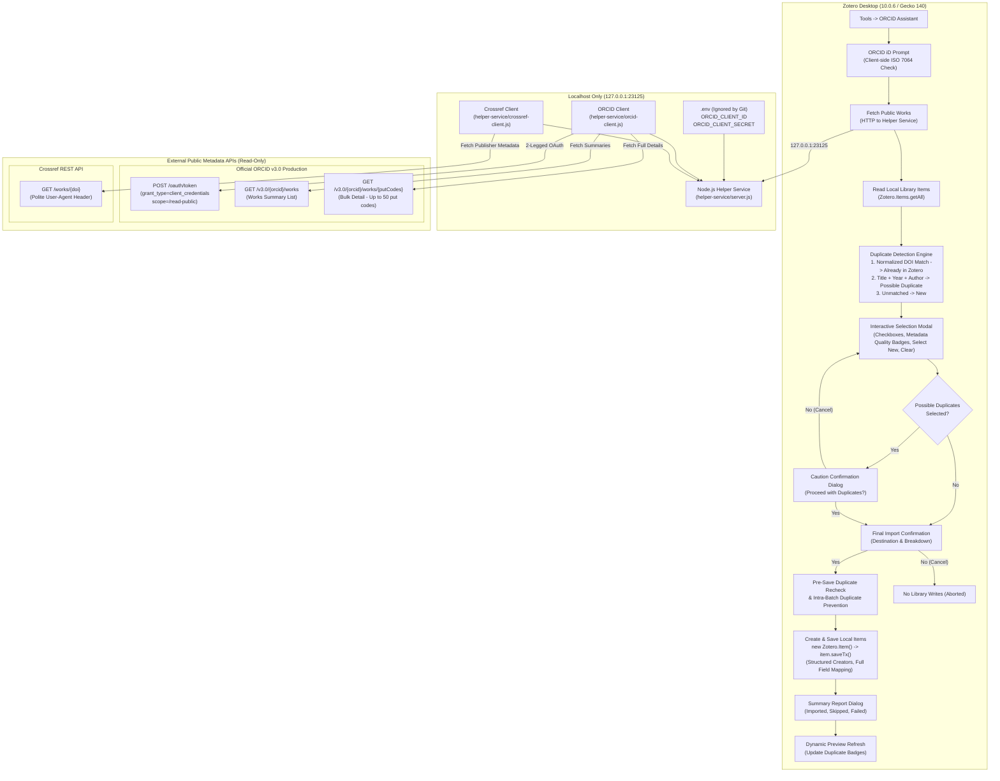

# ORCID Assistant for Zotero 7+

**ORCID Assistant** is an open-source Zotero desktop plugin designed to streamline importing, verifying, and linking researcher publication records from [ORCID](https://orcid.org) directly into your local Zotero library.

> **Step 4.1 Implementation Status: Robust Bibliographic Metadata Enrichment and Reliable Zotero Import**  
> Builds on the verified Step 1 lifecycle, Step 2 local helper service, Step 3 duplicate detection engine, and Step 4 selected-publication import:
> * **Root-Cause Resolution for Incomplete Metadata**: Solved missing author, journal, volume, issue, and page details caused by ORCID's `/works` summary endpoint omitting contributors and field metadata.
> * **Bulk ORCID Work Detail Retrieval**: Fetches complete work records via the official ORCID Public API v3.0 bulk endpoint (`GET /v3.0/{orcid}/works/{putCodes}`, up to 50 items per request) to retrieve detailed contributors, full journal titles, BibTeX citations, and external IDs.
> * **Public Crossref API Integration**: Automatically queries Crossref (`https://api.crossref.org/works/{doi}`) using a polite User-Agent to retrieve publisher-authoritative metadata: structured author given/family names, full `container-title`, `journalAbbreviation`, `volume`, `issue`, `page`/article-number, `ISSN`, `publisher`, canonical `URL`, and cleaned abstracts.
> * **Strict Source Precedence Rules**: Merges ORCID details, Crossref records, and BibTeX citations with strict precedence (Crossref > ORCID Detail > BibTeX > ORCID Summary) while strictly verifying that Crossref response DOIs match requested DOIs.
> * **Complete Zotero Item Field Mapping**: Correctly maps fields across all major item types (`journalArticle`, `book`, `bookSection`, `conferencePaper`, `report`, `thesis`, `preprint`, `dataset`, `patent`). Guarantees journal titles map to `publicationTitle` and never `publisher`!
> * **Structured Creator Management**: Builds official Zotero `creators` arrays with separated `firstName` and `lastName`, while preserving institutional and organizational authors with `fieldMode: 1`.
> * **Metadata Quality & Source Transparency**: Displays real-time metadata quality indicators in preview cards (`[ORCID + Crossref]`, enriched fields, missing fields) so users inspect data completeness before importing.
> * **Strict ORCID Read-Only Guarantee**: Writes strictly to the user's local Zotero library; zero ORCID write scopes requested, zero push/edit/delete operations on ORCID.
> * **Isolated Local Architecture**: Credentials remain in `.env` on localhost (`127.0.0.1:23125`); `dist/orcid-assistant.xpi` contains zero credentials and zero helper code.

---

## 1. Architecture & Metadata Enrichment Pipeline



### Components

* **`src/manifest.json`**: WebExtension manifest (`manifest_version: 2`) configured with `applications.zotero` (`strict_min_version: "7.0"`, `strict_max_version: "10.0.*"`, and `update_url`).
* **`src/bootstrap.js`**: Gecko restartless lifecycle hooks (`startup`, `shutdown`, `onMainWindowLoad`, etc.).
* **`src/orcid-assistant.js`**: Core plugin logic. Manages `Zotero.MenuManager` integration, input dialogs, client-side ORCID normalization/checksum verification, helper communication, local duplicate detection, interactive modal UI, metadata quality assessment, structured creator normalization, Zotero item field mapping across 9 item types, pre-save duplicate rechecking, and import execution.
* **`helper-service/crossref-client.js`**: Crossref API integration with polite User-Agent, strict DOI normalization and verification guard, in-memory caching to eliminate duplicate requests, JATS abstract tag cleaning, and structured author extraction.
* **`helper-service/orcid-client.js`**: 2-legged OAuth token management (in-memory TTL cache), ORCID v3.0 works summary parser, bulk detail retrieval (`/works/{putCodes}`), BibTeX citation parser, contributor parser, and multi-source enrichment pipeline.
* **`helper-service/server.js`**: Localhost-only HTTP server bound strictly to `127.0.0.1:23125`. Exposes `/health`, `/api/works`, and `/api/enrich-doi`.
* **`.env.example`**: Safe configuration template for local development credentials.
* **`scripts/build.js`**: Packages only `src/` into `dist/orcid-assistant.xpi` (strictly isolates `.env` and `helper-service/`).
* **`scripts/test.js`**: Automated plugin tests (248 passing assertions).
* **`helper-service/test.js`**: Automated helper service and enrichment tests (102 passing assertions).

---

## 2. Root Cause Analysis & Precedence Rules

### Why Metadata Was Previously Incomplete
1. **ORCID Summary Limitations**: The standard ORCID `GET /v3.0/{orcid}/works` endpoint returns only `<work:work-summary>` elements. These elements intentionally omit contributor/author lists, volume, issue, page numbers, abstracts, and often container/journal titles.
2. **False Depositor Fallback**: In Step 3/4, when contributor lists were empty in the summary, code fell back to `assertion-origin-name`—the entity that deposited the record (e.g., "Crossref" or the profile owner), rather than the actual authors of the paper.
3. **Missing Work Detail Queries**: Full ORCID contributor lists and citations are only available via `GET /v3.0/{orcid}/work/{putCode}` or the bulk `GET /v3.0/{orcid}/works/{putCodes}` endpoint.
4. **Lack of Publisher-Level Enrichment**: ORCID records frequently lack volume, issue, page ranges, ISSN, and complete author given names. Crossref provides this authoritative publisher metadata when a valid DOI exists.

### Source Precedence Hierarchy

| Metadata Field | Priority 1 | Priority 2 | Priority 3 | Priority 4 |
| :--- | :--- | :--- | :--- | :--- |
| **Title** | Crossref (Full title + subtitle) | ORCID Work Detail | BibTeX `title` | ORCID Summary |
| **Authors / Creators** | Crossref (`author` with `given` & `family`) | ORCID Detail (`contributors`) | BibTeX `author` | ORCID Summary |
| **Publication / Journal** | Crossref (`container-title`) | ORCID Detail (`journal-title`) | BibTeX `journal`/`booktitle` | ORCID Summary |
| **Journal Abbreviation** | Crossref (`short-container-title`) | — | — | — |
| **Volume** | Crossref (`volume`) | BibTeX `volume` | — | — |
| **Issue** | Crossref (`issue`) | BibTeX `number` | — | — |
| **Pages** | Crossref (`page` / `article-number`) | BibTeX `pages` | — | — |
| **Date / Year** | Crossref (`published` / `created`) | ORCID Detail (`publication-date`) | BibTeX `year` | ORCID Summary |
| **DOI** | Crossref (Strictly verified) | ORCID External IDs (`doi`) | BibTeX `doi` | ORCID Summary |
| **ISSN / ISBN** | Crossref (`ISSN`, `ISBN`) | ORCID External IDs | BibTeX `issn`/`isbn` | — |
| **URL** | Crossref (Canonical resource URL) | ORCID Detail (`url`) | BibTeX `url` | DOI URL fallback |
| **Abstract** | Crossref (`abstract` with JATS cleaned) | — | — | — |
| **Provenance** | Recorded in Zotero `extra` as: `ORCID: {id}\nORCID-Put-Code: {putCode}\nSources: {sources}` |

---

## 3. Zotero Item Field Mapping Table

The plugin maps metadata across 9 official Zotero item types. Journal titles are **always** mapped to `publicationTitle`, never `publisher`!

| ORCID Work Type | Zotero Item Type | Primary Mapped Fields | Notes |
| :--- | :--- | :--- | :--- |
| `journal-article`, `journal-issue` | `journalArticle` | `title`, `creators`, `publicationTitle`, `journalAbbreviation`, `volume`, `issue`, `pages`, `date`, `DOI`, `ISSN`, `url`, `abstractNote`, `language`, `extra` | Journal name correctly mapped to `publicationTitle`. |
| `book`, `edited-book` | `book` | `title`, `creators`, `publisher`, `date`, `numPages`, `ISBN`, `DOI`, `url`, `abstractNote`, `language`, `extra` | Book publisher and ISBN populated. |
| `book-chapter`, `book-section` | `bookSection` | `title`, `creators`, `bookTitle` (container), `publisher`, `volume`, `pages`, `date`, `ISBN`, `DOI`, `url`, `abstractNote`, `extra` | Container mapped to `bookTitle`. |
| `conference-paper`, `proceedings-article` | `conferencePaper` | `title`, `creators`, `proceedingsTitle` (container), `publisher`, `volume`, `pages`, `date`, `DOI`, `url`, `abstractNote`, `extra` | Container mapped to `proceedingsTitle`. |
| `report` | `report` | `title`, `creators`, `institution` (publisher), `date`, `pages`, `DOI`, `url`, `abstractNote`, `extra` | Technical/scientific report. |
| `dissertation`, `dissertation-thesis` | `thesis` | `title`, `creators`, `university` (publisher), `date`, `numPages`, `DOI`, `url`, `abstractNote`, `extra` | Academic dissertation/thesis. |
| `patent` | `patent` | `title`, `creators`, `issueDate` (`date`), `url`, `abstractNote`, `extra` | Patent record. |
| `preprint` | `preprint` | `title`, `creators`, `repository` (container), `date`, `DOI`, `url`, `abstractNote`, `extra` | Working paper / preprint. |
| `data-set` | `dataset` | `title`, `creators`, `repository` (container), `date`, `DOI`, `url`, `abstractNote`, `extra` | Research dataset. |
| *Other / Unknown* | `journalArticle` | `title`, `creators`, `publicationTitle`, `volume`, `issue`, `pages`, `date`, `DOI`, `url`, `abstractNote`, `extra` | Safe fallback without metadata loss. |

### Creator Structuring Rules
* **Personal Authors**: Separated into `firstName` (given name) and `lastName` (family name) with `creatorType: "author"`.
* **Institutional Authors**: Organizations (e.g., `ATLAS Collaboration`, `World Health Organization`, `University of Oxford`) are saved with `fieldMode: 1` so Zotero treats them as single-field names rather than splitting them into given and family names.

---

## 4. Duplicate Detection & Selection Hierarchy

| Priority | Match Type | Criteria | Status Label | Default Selection |
| :--- | :--- | :--- | :--- | :--- |
| **1 (Strongest)** | **Normalized DOI** | Normalized DOIs match exactly (case-insensitive, URL prefixes `https://doi.org/`, `http://dx.doi.org/`, and `doi:` stripped). | **`[Already in Zotero]`** | **Unchecked** (Excluded by default) |
| **2 (Secondary)** | **Title + Year + Author** | DOI missing on one or both records; normalized titles match, publication years match, and author metadata aligns. | **`[Possible Duplicate]`** | **Unchecked** (Requires caution confirmation) |
| **3 (Secondary)** | **Title + Author** | DOI missing on one or both records, year unavailable on one or both, but normalized titles match and author metadata aligns. | **`[Possible Duplicate]`** | **Unchecked** (Requires caution confirmation) |
| **4 (Negative)** | **Title-Only Similarity** | Titles match, but publication years conflict (e.g. 2012 vs 2021), authors conflict, or both year and author are missing. | **`[New]`** *(Title-only similarity is never treated as duplicate)* | **Checked** |
| **5 (Unmatched)** | **No Match** | No matching DOI, title, or authors found in the local library. | **`[New]`** | **Checked** |
| **6 (Edge Case)** | **Empty Library** | When local library contains 0 items, all fetched publications are safely labeled. | **`[New]`** | **Checked** |

---

## 5. Safe Local Setup Instructions

### Prerequisites
* **Node.js**: v18+ (tested on Node v24.18.0)
* **Zotero Desktop**: Zotero 7.0+ or Zotero 10.0.6
* **ORCID Public API Credentials**: Register a free application at [orcid.org/developer-tools](https://orcid.org/developer-tools) to obtain a Client ID and Client Secret.

### Step 1: Install Dependencies
```bash
npm install
```

### Step 2: Configure Local Environment
Copy the example environment file:
```bash
cp .env.example .env
```
*(On Windows PowerShell: `Copy-Item .env.example .env`)*

Edit `.env` with your ORCID Public API credentials:
```env
PORT=23125
HOST=127.0.0.1
ORCID_CLIENT_ID=APP-XXXXXXXXXXXXXXXX
ORCID_CLIENT_SECRET=xxxxxxxx-xxxx-xxxx-xxxx-xxxxxxxxxxxx
```

### Step 3: Start the Local Helper Service
In a terminal window:
```bash
npm run helper
```
Output:
```
[Helper] Loading environment from: .../.env
[Helper] Service running on http://127.0.0.1:23125
[Helper] Security notice: Bound to localhost only.
```

### Step 4: Build and Package Plugin
In a second terminal window:
```bash
npm run package
```
This builds `dist/orcid-assistant.xpi` and runs the complete automated test suite (350 checks across plugin, helper, and enrichment).

---

## 6. Manual Verification in a Separate Zotero Profile

### Safe Testing Recommendation
> [!TIP]
> Always verify on a dedicated Zotero testing profile before using on your primary research library:
> 1. Launch Zotero Profile Manager: `zotero.exe -P` (Windows) or `/Applications/Zotero.app/Contents/MacOS/zotero -P` (macOS).
> 2. Create and start a test profile named `ORCID-Test`.

### Step 6.1: Install the Plugin
1. Open Zotero with the test profile.
2. In the top menubar, navigate to **Tools** → **Plugins** (or **Tools** → **Add-ons**).
3. Click the gear icon (⚙️) located in the upper-right corner.
4. Select **"Install Add-on From File..."**.
5. Select `dist/orcid-assistant.xpi` from this project directory.
6. Click **Install**. The add-on activates immediately without restart.

### Step 6.2: Launch ORCID Assistant & Preview Works
1. In Zotero, click **Tools** → **ORCID Assistant**.
2. Enter a public ORCID identifier (e.g. `0000-0002-1825-0097` or your own public profile).
3. Click **OK**.
4. The **ORCID Assistant — Public Works Import** window opens.
5. Inspect the enriched publication cards:
   * Notice the metadata badge: **`[ORCID + Crossref]`** or **`[ORCID]`**.
   * Note populated fields: Authors (`Given Family`), Journal / Publication, Volume, Issue, Pages, and DOI.
   * Duplicate status badges correctly flag items as **`New`**, **`Possible Duplicate`**, or **`Already in Zotero`**.

### Step 6.3: Import Selected Records
1. Use **Select New** to select all new publications (or select individual checkboxes).
2. Click **Import Selected (N)**.
3. Review the confirmation dialog specifying target library `My Library` and item counts.
4. Click **OK** to proceed.
5. The **Import Summary** confirms the number of records imported.
6. Verify in Zotero's main pane:
   * Item type is correct (e.g., `Journal Article`).
   * Author names are split properly into Last Name and First Name fields.
   * Publication title contains the journal name (not the publisher!).
   * Volume, Issue, Pages, DOI, URL, and Date are all populated.
   * `Extra` field contains `ORCID: ...`, `ORCID-Put-Code: ...`, and `Sources: ...`.

---

## 7. Automated Test Suite (350 Passing Tests)

Run all tests:
```bash
npm test
```

### Plugin Verification (`scripts/test.js` - 248 Tests)
* **Manifest & Compatibility**: Manifest v2 compatibility and strict version bounds (`7.0` - `10.0.*`).
* **Gecko Lifecycle**: Startup, shutdown, window attachment, Tools menu registration, clean cleanup.
* **Step 1 Dialog**: Preserved `ORCID Assistant is running.` confirmation dialog.
* **ORCID Validation**: Format regex, URL prefix normalization, and ISO 7064 MOD 11-2 check digit verification.
* **Helper Client**: Mocked success, empty works, missing credentials, 404 not found, network offline, and timeout responses.
* **Duplicate Detection Matrix**:
  * Exact normalized DOI match -> `[Already in Zotero]`.
  * DOI casing and prefix variations -> `[Already in Zotero]`.
  * Missing DOI with matching title + year + author -> `[Possible Duplicate]`.
  * Title variations (punctuation/case) with matching year & author -> `[Possible Duplicate]`.
  * Missing year on both with matching author -> `[Possible Duplicate]`.
  * Missing author with matching year -> `[Possible Duplicate]`.
  * Same title, but conflicting years -> `[New]` (title-only similarity NOT treated as duplicate).
  * Same title, but conflicting authors -> `[New]`.
  * Same title, but both year and author missing -> `[New]`.
  * Unmatched paper -> `[New]`.
  * Empty local library -> All works labeled `[New]`.
* **Step 4.1 Metadata Normalization & Creator Management**:
  * Author parsing: structured `creators` with `firstName`, `lastName`, and institutional author `fieldMode: 1`.
  * String creator parsing fallback (`Last, First` and `First Last`).
  * Field setting: title, normalized DOI, date, publicationTitle, journalAbbreviation, volume, issue, pages, ISSN, ISBN, URL, abstractNote, language, and provenance `extra`.
  * Type-specific mappings for `journalArticle`, `book`, `bookSection`, `conferencePaper`, `report`, `thesis`, `preprint`, `dataset`, `patent`.
  * Safe field assignment preventing invalid field exceptions.
* **Step 4.1 Metadata Quality Assessment**:
  * Completeness score calculation.
  * Identification of enriched vs missing fields.
  * Quality assessment presentation in preview UI.
* **Step 4 Import Execution & Duplicate Recheck Safeguards**:
  * Pre-save duplicate rechecking: items detected as duplicates immediately before save are skipped.
  * Intra-batch duplicate prevention: multiple items in the same batch sharing a DOI save only once and skip duplicates.
  * Partial failure handling: failing items do not block other valid items.
* **Step 4 Confirmation Dialogs**:
  * Cancellation safeguards at all confirmation stages.
* **Step 4 Interactive Selection UI (DOM Modal)**:
  * Modal overlay rendering and cleanup via `removeFromWindow`.
  * Default selection state (`New` checked; `Already in Zotero` and `Possible Duplicate` unchecked).
  * Live selection summary count updates (`X of Y selected`).
* **Security & Non-Interference**:
  * Helper service requests strictly `/read-public` scope (zero `/activities/update`, zero `/read-limited`).
  * Helper service issues strictly `GET` requests for works; zero `PUT` or `DELETE` requests.
  * Plugin issues zero `POST`, `PUT`, or `DELETE` requests to ORCID.
  * XPI archive verification: strictly excludes `.env`, helper service files, and client credentials.

### Helper Service & Enrichment Verification (`helper-service/test.js` - 102 Tests)
* **ORCID Validation**: ISO 7064 check digit validation unit tests.
* **Credential Handling**: Missing credential detection and error sanitization without leaking tokens.
* **OAuth & Works**: Mocked 2-legged OAuth token acquisition (`/read-public`) and in-memory TTL caching.
* **Crossref Client**:
  * Strict DOI normalization and prefix stripping (`https://doi.org/`, `http://dx.doi.org/`, `doi:`).
  * Strict DOI response matching guard (rejects mismatched DOIs).
  * In-memory cache hit verification (eliminates redundant network calls for identical DOIs).
  * Date parsing: full `YYYY-MM-DD`, `YYYY-MM`, and `YYYY` without inventing missing parts.
  * JATS and HTML abstract tag stripping.
  * Structured author extraction: personal given/family names and institutional `fieldMode: 1`.
  * Container title, journal abbreviation, volume, issue, pages, ISSN, and publisher parsing.
  * Graceful handling of Crossref 404s and timeouts (8000ms).
* **ORCID Detail & BibTeX Parsing**:
  * BibTeX parser extracting volume, issue/number, pages, journal, year, and authors.
  * ORCID contributor parser extracting personal given/family names, ORCID iDs, and institutional authors.
* **Enrichment & Precedence Integration**:
  * Verified Crossref > ORCID Detail > BibTeX > ORCID Summary precedence.
  * Enriched fields tracking and completeness scoring.
  * Fallback behavior when Crossref is unavailable.
* **HTTP Server Endpoints**:
  * `GET /health` returns 200 OK with `127.0.0.1` binding confirmation.
  * `GET /api/enrich-doi` validation and response testing.
  * `GET /api/works` validation and error handling.

---

## 8. Safety & Security Guarantees
* **Local Library Write Only**: Items are created strictly in the user's local Zotero library using official `Zotero.Item` APIs (`saveTx()`).
* **Strictly Read-Only from ORCID**: Zero write scopes are requested (`/activities/update` is never used). The plugin never modifies, pushes, or deletes records on ORCID.
* **Credential Isolation**: Client secret and `.env` file remain exclusively on the local machine and are **never** packaged into `dist/orcid-assistant.xpi`.
* **Explicit User Confirmation**: No items are ever imported automatically when opening the plugin or previewing results.
* **Zero Zotero Core Modifications**: Completely self-contained as a clean, restartless WebExtension-based add-on.
